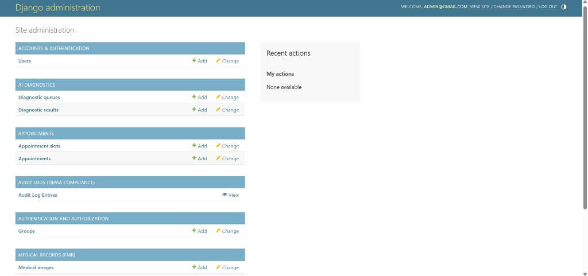
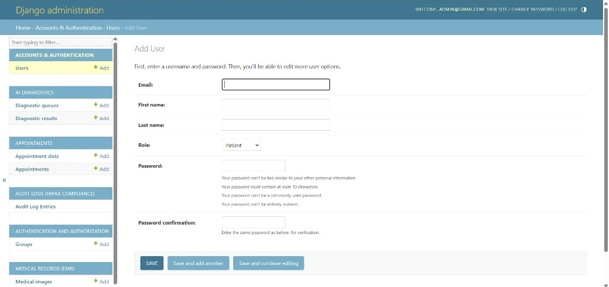
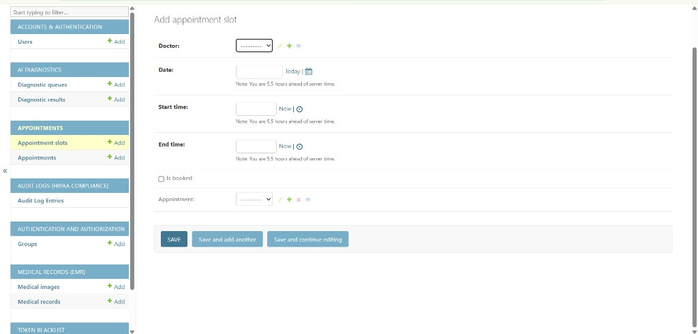
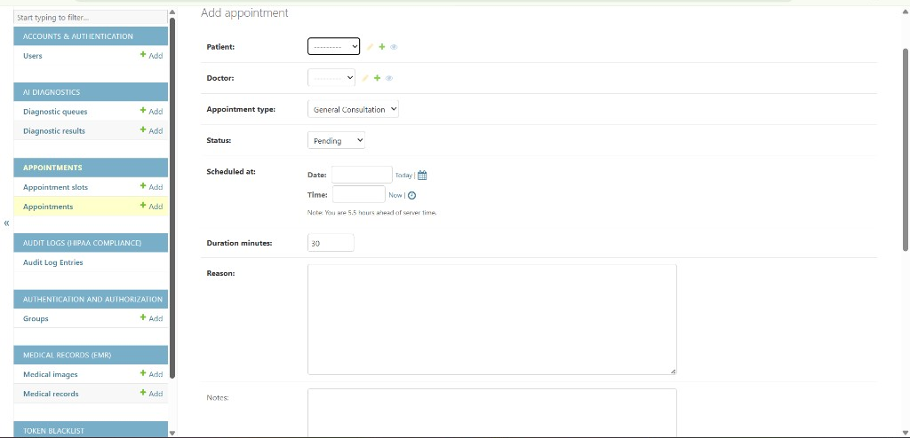
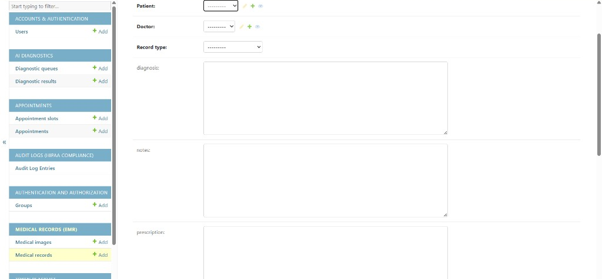
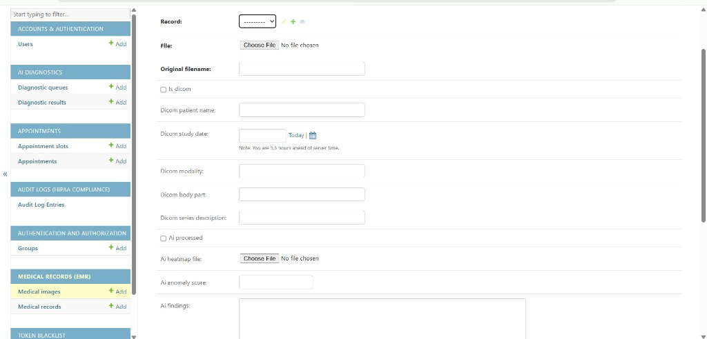
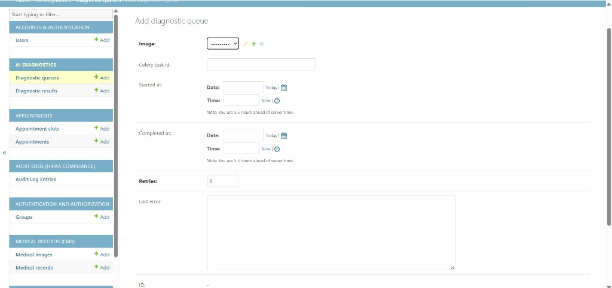
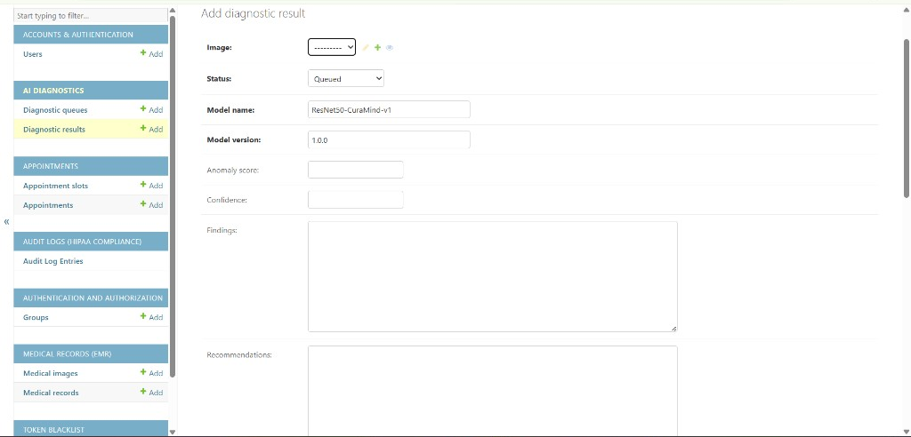

# 🏥 CuraMind AI — HIPAA-Compliant Telehealth & Diagnostics Platform

> **Project 2 of Zaalima Development Q4 Python Elite Track**
> Django · Celery · PostgreSQL · Redis · DICOM · AI Diagnostics

---

## 📐 Architecture Overview

```
┌──────────────────────────────────────────────────────────┐
│                         Nginx                            │
│          (Reverse Proxy · SSL · Load Balancing)          │
└──────────────┬───────────────────────────────────────────┘
               │
       ┌───────▼────────┐         ┌──────────────────┐
       │  Django + DRF  │◄───────►│   PostgreSQL 15  │
       │  (Gunicorn ×4) │         │  (Encrypted EMR) │
       └───────┬────────┘         └──────────────────┘
               │
       ┌───────▼────────┐         ┌──────────────────┐
       │     Redis      │◄───────►│  Celery Worker   │
       │ (Cache/Broker) │         │ (AI Image Pipeline)│
       └────────────────┘         └──────────────────┘
```

---

## 🗂️ Project Structure

```
curamind/
├── apps/
│   ├── accounts/          # Custom User model · RBAC · JWT Auth
│   ├── appointments/      # Appointment booking & scheduling
│   ├── medical_records/   # Encrypted EMR · Secure file upload
│   ├── diagnostics/       # AI image analysis · DICOM processing
│   └── audit/             # Immutable HIPAA compliance log
├── curamind/              # Django settings · Celery · URLs
├── nginx/                 # Nginx reverse proxy config
├── tests/                 # pytest test suite (>80% coverage)
├── docs/
│   └── screenshots/       # Django admin screenshots (README)
├── docker-compose.yml
├── Dockerfile
├── requirements.txt
├── .env.example
└── manage.py
```

---

## ⚙️ Environment Variables — What You Need to Set

Copy `.env.example` to `.env` and fill in the following:

### 🔴 Required (App won't start without these)

| Variable | Description | How to Get It |
|---|---|---|
| `SECRET_KEY` | Django secret key | Run: `python -c "from django.core.management.utils import get_random_secret_key; print(get_random_secret_key())"` |
| `DB_NAME` | PostgreSQL database name | Your DB setup |
| `DB_USER` | PostgreSQL username | Your DB setup |
| `DB_PASSWORD` | PostgreSQL password | Your DB setup |
| `ENCRYPTION_KEY` | Fernet key for encrypting medical data at rest | Run: `python -c "from cryptography.fernet import Fernet; print(Fernet.generate_key().decode())"` |

### 🟡 Required for Email Alerts (High-risk diagnostic alerts)

| Variable | Description |
|---|---|
| `EMAIL_HOST_USER` | Gmail / SMTP address |
| `EMAIL_HOST_PASSWORD` | Gmail App Password (not your login password) |

> **Gmail setup:** Go to Google Account → Security → 2FA → App Passwords → Generate one for "Mail"

### 🔵 Required for Production (S3 file storage)

| Variable | Description |
|---|---|
| `USE_S3` | Set to `True` in production |
| `AWS_ACCESS_KEY_ID` | AWS IAM key with S3 access |
| `AWS_SECRET_ACCESS_KEY` | AWS IAM secret |
| `AWS_STORAGE_BUCKET_NAME` | Your S3 bucket name |
| `AWS_S3_REGION_NAME` | e.g. `us-east-1` |

---

## 🚀 Quick Start (Local Development)

### Option A — Docker Compose (Recommended)

```bash
# 1. Clone and enter the project
cd curamind

# 2. Set up environment
cp .env.example .env
# Edit .env — fill in SECRET_KEY, DB_PASSWORD, ENCRYPTION_KEY at minimum

# 3. Start all services
docker-compose up --build

# 4. Create a superuser (in a new terminal)
docker-compose exec web python manage.py createsuperuser

# 5. Access the app
#    API Docs:      http://localhost:80/api/docs/
#    Django Admin:  http://localhost:80/admin/
#    Flower:        http://localhost:5555/
```

### Option B — Manual Setup

```bash
# 1. Create virtual environment
python -m venv venv
source venv/bin/activate  # Windows: venv\Scripts\activate

# 2. Install dependencies
pip install -r requirements.txt

# 3. Install system dependency for python-magic
#    Ubuntu/Debian:  sudo apt-get install libmagic1
#    macOS:          brew install libmagic

# 4. Set up environment
cp .env.example .env
# Edit .env (set DEBUG=True, fill in DB and keys)

# 5. Set up PostgreSQL
createdb curamind_db
createuser curamind_user
psql -c "ALTER USER curamind_user WITH PASSWORD 'yourpassword';"
psql -c "GRANT ALL PRIVILEGES ON DATABASE curamind_db TO curamind_user;"

# 6. Run migrations
python manage.py migrate

# 7. Create superuser
python manage.py createsuperuser

# 8. Start Redis (in a separate terminal)
redis-server

# 9. Start Celery worker (in a separate terminal)
celery -A curamind worker --loglevel=info

# 10. Start Django dev server
python manage.py runserver
```

---

## 📸 Django admin (screenshots)

After you create a superuser and open `http://localhost:8000/admin/` (or port `80` with Docker), the built-in Django administration UI groups **accounts**, **AI diagnostics**, **appointments**, **HIPAA audit logs**, **EMR**, and **token blacklist** in one place. The images below are from a local run (`localhost`).

### Site administration index

Overview of registered models: users, diagnostic queues and results, appointment slots and appointments, read-only audit log viewing, groups, medical images and records.



### Users — email login and roles

Custom user form: email as the identifier, name fields, **Role** (e.g. Patient), and password rules.



### Appointments

**Appointment slots** tie a doctor to a date and time window, optional booking flag, and optional link to an appointment.



**Appointments** link patient and doctor, type, status, scheduled time (with server timezone note), duration, reason, and notes.



### Medical records (EMR)

**Medical records** associate patient and doctor, record type, diagnosis, notes, and prescription.



**Medical images** attach to a record: file upload, DICOM flag and metadata fields, and AI fields (processed flag, heatmap, anomaly score, findings).



### AI diagnostics

**Diagnostic queue** tracks async work: linked image, Celery task id, start/completion times, retries, and last error.



**Diagnostic result** stores model name/version (e.g. ResNet50-CuraMind-v1), status, anomaly score, confidence, findings, and recommendations.



---

## 📡 API Endpoints

| Method | Endpoint | Description | Role |
|--------|----------|-------------|------|
| POST | `/api/v1/auth/register/` | Register new user | Public |
| POST | `/api/v1/auth/login/` | Get JWT tokens | Public |
| POST | `/api/v1/auth/logout/` | Blacklist refresh token | Auth |
| GET/PUT | `/api/v1/auth/profile/` | View/edit own profile | Auth |
| GET | `/api/v1/auth/doctors/` | List available doctors | Auth |
| GET/POST | `/api/v1/appointments/` | List/book appointments | Auth |
| GET | `/api/v1/appointments/upcoming/` | Upcoming appointments | Auth |
| GET/POST | `/api/v1/records/` | List/create EMR | Doctor/Nurse |
| GET/PUT | `/api/v1/records/{id}/` | View/update record | Doctor/Owner |
| POST | `/api/v1/records/{id}/images/` | Upload medical image | Doctor/Nurse |
| GET | `/api/v1/diagnostics/` | AI diagnostic results | Doctor/Radiologist |
| GET | `/api/v1/diagnostics/high-risk/` | Unreviewed high-risk cases | Doctor |
| PATCH | `/api/v1/diagnostics/{id}/` | Add radiologist review | Radiologist |
| GET | `/api/v1/audit/` | Audit log | Admin/Doctor (own) |

**Full interactive docs:** `http://localhost:8000/api/docs/`

---

## 👥 User Roles & Permissions

| Role | Permissions |
|------|------------|
| **Patient** | View own records, book appointments, view own profile |
| **Doctor** | Create/edit records for own patients, view diagnostics, manage appointments |
| **Nurse** | Read-only access to records and appointments |
| **Radiologist** | View and review imaging diagnostic results |
| **Admin** | User management, audit logs — **cannot view patient medical data** (HIPAA) |

---

## 🔒 Security & HIPAA Compliance

- ✅ **Encryption at rest** — Diagnosis, notes, and prescriptions encrypted with Fernet AES-256
- ✅ **RBAC** — Role-based access control on every endpoint
- ✅ **Immutable audit log** — Every record access/edit is logged and cannot be modified
- ✅ **MIME type validation** — File uploads validated by magic bytes, not just extension
- ✅ **Metadata stripping** — DICOM patient PII stripped on upload
- ✅ **JWT auth** — Short-lived access tokens (60 min) + refresh token rotation
- ✅ **SQL injection protection** — Django ORM parameterized queries
- ✅ **Private S3 ACLs** — All medical files stored with private access in production
- ✅ **Security headers** — X-Frame-Options, CSP, HSTS via Nginx

---

## 🧪 Running Tests

```bash
# Run full test suite with coverage
pytest

# Run specific test class
pytest tests/test_curamind.py::TestRBAC -v

# Run with coverage report only
pytest --cov=apps --cov-report=html
# Open htmlcov/index.html in browser
```

---

## 🔄 Celery Tasks

The AI image processing pipeline runs asynchronously:

1. Doctor uploads medical image → HTTP 201 returned immediately
2. Celery picks up `process_medical_image` task
3. DICOM metadata parsed (pydicom) and PII stripped
4. AI model runs inference → anomaly score (0.0–1.0)
5. Heatmap generated and saved
6. `DiagnosticResult` record created
7. If score ≥ 0.7 → `send_high_risk_alert` task sends email to doctor

Monitor tasks at: `http://localhost:5555` (Flower dashboard)

---

## 🏗️ Week-by-Week Delivery Plan

| Week | Focus | Key Deliverables |
|------|-------|-----------------|
| Week 1 | Planning & Compliance | HIPAA checklist, DB schema with encryption, RBAC design |
| Week 2 | Core Platform | Custom User model, appointment API, secure file uploads |
| Week 3 | AI Integration | Celery pipeline, DICOM parsing, CV model, heatmaps |
| Week 4 | Deployment | SSL/TLS, AWS S3, Docker production config, full test suite |

---

*CuraMind AI — Building the Future, One Line at a Time.*
*Zaalima Development Pvt. Ltd. — Q4 Python Elite Track*
